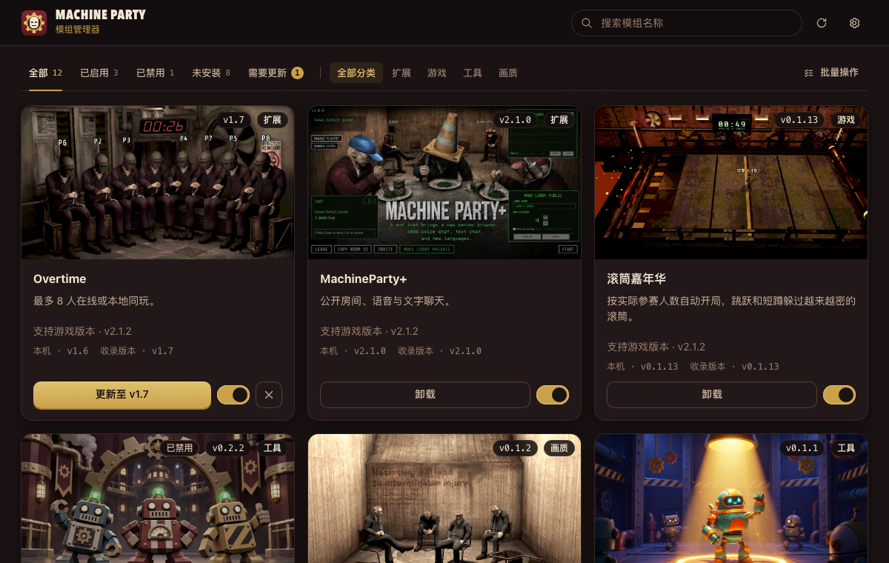
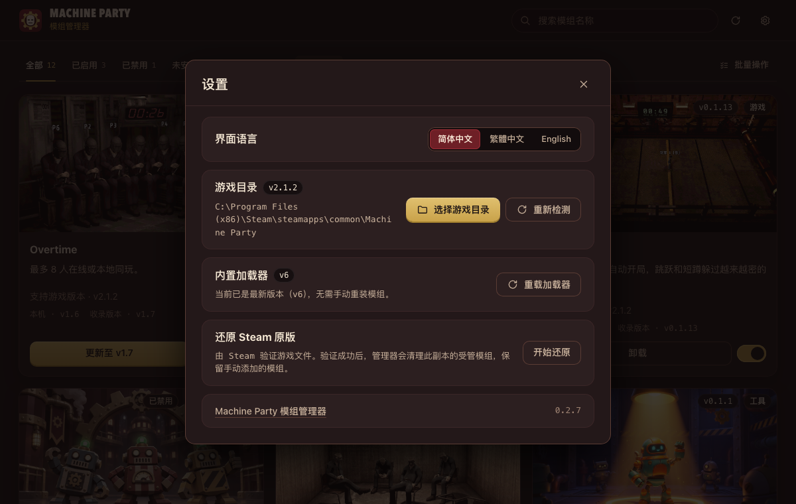

# Machine Party 模组管理器

### 为 Machine Party 打造的一键模组管理器。

在同一个窗口浏览 [Machine Party](https://store.steampowered.com/app/4108000/Machine_Party/) 的精选收录模组，按游戏副本对比版本，并在校验与备份保护下完成安装与还原。

  
  
  

  
  

**[下载](#下载)** · [开始使用](#开始使用) · [文档](../zh-CN/README.md) · [更新记录](../zh-CN/CHANGELOG.md)

[English](../../README.md) · **简体中文** · [繁體中文](README.zh-TW.md)

  

模组目录显示各模组的收录版本、分类、实时联动数量的状态与分类筛选以及批量操作模式。

## 一目了然

| 精选收录模组 | 校验备份，安全还原 | 镜像加速与签名更新 |
| --- | --- | --- |
| 支持简体中文、繁体中文与英文名称搜索、联机说明与作者主页入口，覆盖目录内全部模组。 | 修改文件前先检查游戏进程、基线指纹与互斥冲突；按游戏副本保留可校验备份，支持离线卸载还原。 | 目录同步与已授权安装包优先经项目 Cloudflare Worker 获取，不依赖访问 GitHub；应用更新带签名校验与更新说明。 |

Steam 目录自动检测 · 离线缓存与还原 · 简体中文 / 繁體中文 / English 三语界面

## 下载

直接通过下方镜像链接或前往 [GitHub Releases](https://github.com/JamesGZM/machine-party-mod-manager/releases/latest) 下载对应平台安装包。

| 平台 | 架构 | 下载 | 说明 |
| --- | --- | --- | --- |
| Windows | x64 | [正式版 v0.2.5（`setup.exe`）](https://machineparty.ailaogong.men/v1/app-downloads/0.2.5/setup.exe) | NSIS 安装包，支持签名应用内更新 |

下载并运行 Windows x64 安装程序。

已安装的 Windows 客户端会在更新前校验更新包签名。

## 后续计划

《机械派对》目前仅支持 Windows。macOS 管理器列入后续计划。

## 开始使用

1. 启动管理器，应用会自动定位 Steam 中的 *Machine Party*（App ID `4108000`），也可在**设置**手动选择游戏目录。
2. 支持三语搜索与浏览全部已收录模组，点击标题可查看联机要求、冲突规则、兼容游戏版本与作者主页。
3. 点击**安装**。如果游戏正在运行，保存进度后选择**关闭游戏并继续**。管理器会校验套件并备份文件，然后安装。
4. 可按状态（**全部**、**已安装**、**未安装**、**需要更新**）或分类（**扩展**、**游戏**、**工具**、**画质**）筛选，进入**批量操作**模式一次安装、更新或卸载多个模组；点击右上角齿轮可打开**设置**弹窗（切换界面语言、更换游戏目录、管理内置加载器、还原 Steam 原版或检查管理器更新）。

## 桌面应用

| 设置弹窗 | 应用内更新提示 |
| --- | --- |
|  |  |

**v0.2.5** · 顶部单栏全宽布局 · 实时联动数量筛选与批量操作模式 · 独立设置弹窗（内置加载器与还原 Steam 原版）

更新提示截图演示从 0.1.2-11 到 0.1.2-12 的模拟升级。

## 已收录模组

下表列出这份[项目目录](../../catalog/mods.json)的版本。对应的目录修订发布后，管理器才会提供这些版本。

| 模组 | 版本 | 简介 | 适配方式与 `v2.1.2` 状态 |
| --- | --- | --- | --- |
| [Overtime](https://github.com/DarkJadeStone/MachineParty-Overtime) | `v1.7` | 最多 8 人在线或本地同玩 | 作者 CLI 资源清单 → MPML |
| [MachineParty+](https://github.com/Ghostx10742/MachineParty-Plus) | `v2.1.0` | 公开房间、语音与文字聊天 | 原生 MPML |
| [滚筒嘉年华](https://github.com/JamesGZM/machine-party-mod-manager/tree/main/mods/roller-carnival) | `v0.1.12` | 机械狂欢躲避小游戏 | 原生 MPML |
| [Lobby Bots](https://github.com/JamesGZM/machine-party-mod-manager/tree/main/mods/lobby-bots) | `v0.2.2` | 房主可添加或移除默认就绪的测试机器人。 | 原生 MPML |
| [独立高清](https://github.com/JamesGZM/machine-party-mod-manager/tree/main/mods/standalone-hd) | `v0.1.2` | 提高 3D 渲染清晰度，保留窗口模式和 HUD 布局 | 原生 MPML |
| [玩家聚光灯](https://github.com/JamesGZM/machine-party-mod-manager/tree/main/mods/player-spotlight) | `v0.1.1` | 在所有 3D 小游戏中只为自己点亮头顶工业聚光灯 | 原生 MPML |
| [泡泡爆破](https://github.com/JamesGZM/machine-party-mod-manager/tree/main/mods/bubble-blitz) | `v0.1.6` | 3 滴血结合版泡泡堂小游戏，4 套随机地图与传送带互坑 | 原生 MPML |
| [尖刺圆环](https://github.com/JamesGZM/machine-party-mod-manager/tree/main/mods/spike-ring) | `v0.1.4` | 60 秒重工业环形生存赛：墙壁缺口激光、电锯、伸缩地刺、缩圈尖刺环与空投道具互推 | 原生 MPML |
| [组队派对](https://github.com/JamesGZM/machine-party-mod-manager/tree/main/mods/team-party) | `v0.1.1` | 房间 2–4 队手动/洗牌/拖拽分队、原版小游戏挂接与全模组共享团队注册表 | 原生 MPML |
| [能源抢夺战](https://github.com/JamesGZM/machine-party-mod-manager/tree/main/mods/core-heist) | `v0.1.1` | 纯组队 2–4 队 75 秒能源抢夺对抗：双人合抬反应炉核心共振加速、回收炉磁吸锁与过载偷家 | 原生 MPML |
| [炸弹推车](https://github.com/JamesGZM/machine-party-mod-manager/tree/main/mods/bomb-cart) | `v0.1.1` | 2–4 队 75 秒自适应轨道攻防（直轨／Y 型／十字转盘）：强力撞车、蒸汽阀门火箭助推、震荡脉冲与突然死亡加时 | 原生 MPML |
| [高压绩效](https://github.com/JamesGZM/machine-party-mod-manager/tree/main/mods/voltage-greed) | `v0.1.0` | 3 轮近景电椅贪心博弈（2–8+ 人，支持混战与组队）：按住刷 KPI、松手锁分、硬撑专属 S +12% 偷踹、监工抓摸鱼与工业事件 | 原生 MPML（待 Windows 实机验证） |

验收清单、上游授权边界与互斥组规则详见[候选模组与收录规范](../zh-CN/catalog/mods.md)。

## 更新记录

**v0.2.7** · 在正式版目录开放 **炸弹推车（`v0.1.0`）**（限 2 队铁轨拔河）与 **能源抢夺战（`v0.1.0`）**（2–4 队能源抢夺），并由 **`mpm-core`（`v0.1.1`）** 准入门槛系统与 **`team-party`（`v0.1.1`）** 提供组队支持。[完整更新记录](../zh-CN/CHANGELOG.md)。

## 文档

| 文档 | 用途 |
| --- | --- |
| [产品需求](../zh-CN/requirements.md) | 玩家流程、目录顺序、搜索及验收条件 |
| [现行架构](../zh-CN/architecture/README.md) | 组件、Steam 检测、目录、安装与 ADR |
| [开发指南](../zh-CN/development/README.md) | 环境、目录结构、命令与验证 |
| [模组开发与打包规范](../zh-CN/development/mod-development.md) | 模组开发、测试、目录接入与确定性 R2 打包规范 |
| [发布流程](../zh-CN/development/releasing.md) | 签名桌面更新、更新说明与发布工作流 |
| [候选模组与收录规范](../zh-CN/catalog/mods.md) | 游戏基线、候选清单、授权与验收单 |
| [正式目录交付方案](../zh-CN/catalog/delivery.md) | Worker 目录、所有者批准发布与中国大陆验收（规划中） |
| [界面设计规范](../zh-CN/ui-design.md) | 布局、卡片、设置页、弹窗与规划中的流程 |

全部文档：[docs](../README.md)。

## 隐私

管理器不包含任何遥测或统计埋点。游戏路径（`game-path.json`）、副本安装记录（`installations.json`）、下载缓存与备份文件全部保存在本地；仅在获取在线目录、已授权模组包与签名应用更新时连接项目 Worker。分享诊断信息前请阅读[安全说明](../zh-CN/SECURITY.md)。

## 参与贡献

推荐模组或提交新版本，请填写[模组投稿表单](https://github.com/JamesGZM/machine-party-mod-manager/issues/new?template=mod-submission.yml)。报告问题、提出功能或贡献代码请阅读[贡献指南](../zh-CN/CONTRIBUTING.md)。编码助手遵循 [AGENTS.md](../../AGENTS.md)。获取帮助见[支持说明](../zh-CN/SUPPORT.md)，安全漏洞请按[安全说明](../zh-CN/SECURITY.md)私下报告。

## 许可证

管理器代码采用 [GNU General Public License v3.0 only](../../LICENSE)（SPDX `GPL-3.0-only`）。官方版本免费提供。

Machine Party 模组管理器是社区项目，与游戏开发者无关。游戏、第三方模组与封面图片属于各自的权利人并适用其授权；作者、版本和来源保留在各条目页面。见[第三方声明](../zh-CN/THIRD_PARTY_NOTICES.md)。

## 致谢

- 社区模组作者：[DarkJadeStone (Overtime)](https://github.com/DarkJadeStone/MachineParty-Overtime)、[Ghostx10742 (MachineParty+)](https://github.com/Ghostx10742/MachineParty-Plus)、[Lnksoul (Broadcast 8P Freecam)](https://github.com/Lnksoul/MachineParty_Broadcast8P_Freecam_Patcher)、[Binary1936 (八人联机模组)](https://github.com/Binary1936/machine-party-8p) 与 [Krunk-theduck (MPML)](https://github.com/Krunk-theduck/MachinePartyModLoader)。
- [Tauri](https://tauri.app/) 以及[第三方声明](../zh-CN/THIRD_PARTY_NOTICES.md)中所列的开源 Rust 与 JavaScript 依赖。
