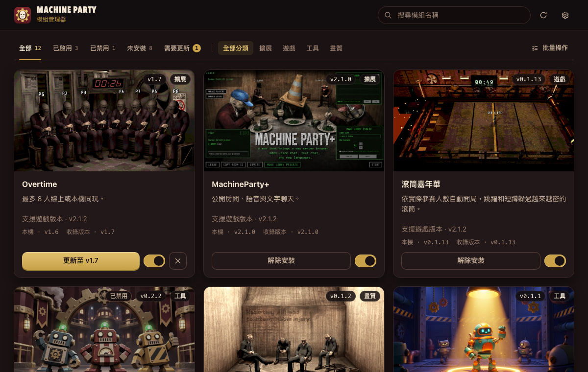
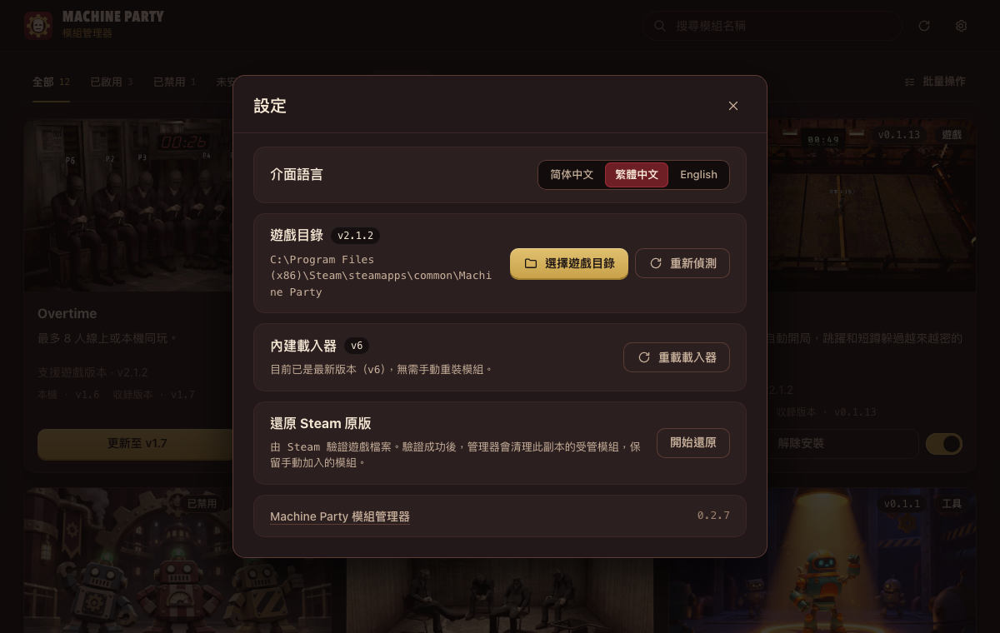

# Machine Party 模組管理器

### 為 Machine Party 打造的一鍵模組管理器。

在同一個視窗瀏覽 [Machine Party](https://store.steampowered.com/app/4108000/Machine_Party/) 的精選收錄模組，依遊戲副本比對版本，並在驗證與備份保護下完成安裝與還原。

  
  
  

  
  

**[下載](#下載)** · [開始使用](#開始使用) · [文件](../zh-TW/README.md) · [更新紀錄](../zh-TW/CHANGELOG.md)

[English](../../README.md) · [简体中文](README.zh-CN.md) · **繁體中文**

  

模組目錄顯示各模組的收錄版本、分類、即時聯動數量的狀態與分類篩選以及批量操作模式。

## 一目了然

| 精選收錄模組 | 校驗備份，安全還原 | 鏡像加速與簽章更新 |
| --- | --- | --- |
| 支援簡體中文、繁體中文與英文名稱搜尋、連線說明與作者首頁入口，涵蓋目錄內全部模組。 | 修改檔案前先檢查遊戲程序、基線指紋與互斥衝突；依遊戲副本保留可校驗備份，支援離線卸載還原。 | 目錄同步與已授權安裝包優先經專案 Cloudflare Worker 取得，不依賴連線 GitHub；應用更新附簽章驗證與更新說明。 |

Steam 目錄自動偵測 · 離線快取與還原 · 简体中文 / 繁體中文 / English 三語介面

## 下載

直接透過下方鏡像連結或前往 [GitHub Releases](https://github.com/JamesGZM/machine-party-mod-manager/releases/latest) 下載對應平台安裝檔。

| 平台 | 架構 | 下載 | 說明 |
| --- | --- | --- | --- |
| Windows | x64 | [正式版 v0.2.5（`setup.exe`）](https://machineparty.ailaogong.men/v1/app-downloads/0.2.5/setup.exe) | NSIS 安裝程式，支援簽章應用內更新 |

下載並執行 Windows x64 安裝程式。

已安裝的 Windows 客戶端會在更新前驗證更新套件簽章。

## 後續計畫

《機械派對》目前僅支援 Windows。macOS 管理器列入後續計畫。

## 開始使用

1. 啟動管理器，應用會自動尋找 Steam 中的 *Machine Party*（App ID `4108000`），也可於**設定**手動選擇遊戲目錄。
2. 支援三語搜尋與瀏覽全部已收錄模組，點擊標題可檢視連線條件、衝突規則、相容遊戲版本與作者倉庫。
3. 點選**安裝**。如果遊戲正在執行，儲存進度後選擇**關閉遊戲並繼續**。管理器會校驗套件並備份檔案，再進行安裝。
4. 可依狀態（**全部**、**已安裝**、**未安裝**、**需要更新**）或分類（**擴展**、**遊戲**、**工具**、**畫質**）篩選，進入**批量操作**模式一次安裝、更新或卸載多個模組；點擊右上角齒輪可開啟**設定**彈窗（切換介面語言、更換遊戲目錄、管理內建載入器、還原 Steam 原版或檢查管理器更新）。

## 桌面應用

| 設定彈窗 | 應用內更新提示 |
| --- | --- |
|  |  |

**v0.2.5** · 頂部單欄全寬版面 · 即時聯動數量篩選與批量操作模式 · 獨立設定彈窗（內建載入器與還原 Steam 原版）

更新提示截圖示範從 0.1.2-11 到 0.1.2-12 的模擬升級。

## 已收錄模組

下表列出這份[專案目錄](../../catalog/mods.json)的版本。對應的目錄修訂發布後，管理器才會提供這些版本。

| 模組 | 版本 | 簡介 | 適配方式與 `v2.1.2` 狀態 |
| --- | --- | --- | --- |
| [Overtime](https://github.com/DarkJadeStone/MachineParty-Overtime) | `v1.7` | 最多 8 人線上或本機同玩 | 作者 CLI 資源清單 → MPML |
| [MachineParty+](https://github.com/Ghostx10742/MachineParty-Plus) | `v2.1.0` | 公開房間、語音與文字聊天 | 原生 MPML |
| [滾筒嘉年華](https://github.com/JamesGZM/machine-party-mod-manager/tree/main/mods/roller-carnival) | `v0.1.12` | 機械狂歡躲避小遊戲 | 原生 MPML |
| [Lobby Bots](https://github.com/JamesGZM/machine-party-mod-manager/tree/main/mods/lobby-bots) | `v0.2.2` | 房主可加入或移除預設就緒的測試機器人。 | 原生 MPML |
| [獨立高清](https://github.com/JamesGZM/machine-party-mod-manager/tree/main/mods/standalone-hd) | `v0.1.2` | 提高 3D 渲染清晰度，保留視窗模式與 HUD 配置 | 原生 MPML |
| [玩家聚光燈](https://github.com/JamesGZM/machine-party-mod-manager/tree/main/mods/player-spotlight) | `v0.1.1` | 在所有 3D 小遊戲中只為自己點亮頭頂工業聚光燈 | 原生 MPML |
| [泡泡爆破](https://github.com/JamesGZM/machine-party-mod-manager/tree/main/mods/bubble-blitz) | `v0.1.6` | 3 滴血結合版泡泡堂小遊戲，4 套隨機地圖與傳送帶互坑 | 原生 MPML |
| [尖刺圓環](https://github.com/JamesGZM/machine-party-mod-manager/tree/main/mods/spike-ring) | `v0.1.4` | 60 秒重工業環形生存賽：牆壁缺口雷射、電鋸、伸縮地刺、縮圈尖刺環與空投道具互推 | 原生 MPML |
| [組隊派對](https://github.com/JamesGZM/machine-party-mod-manager/tree/main/mods/team-party) | `v0.1.1` | 房間 2–4 隊手動／洗牌／拖曳分隊、原版小遊戲掛接與全模組共享團隊註冊表 | 原生 MPML |
| [能源搶奪戰](https://github.com/JamesGZM/machine-party-mod-manager/tree/main/mods/core-heist) | `v0.1.1` | 純組隊 2–4 隊 75 秒能源搶奪對抗：雙人合抬反應爐核心共振加速、回收爐磁吸鎖與過載偷家 | 原生 MPML |
| [炸彈推車](https://github.com/JamesGZM/machine-party-mod-manager/tree/main/mods/bomb-cart) | `v0.1.1` | 2–4 隊 75 秒自適應軌道攻防（直軌／Y 型／十字轉盤）：強力撞車、蒸氣閥門火箭助推、震盪脈衝與突然死亡加時 | 原生 MPML |

驗收清單、上游授權邊界與互斥群組規則詳見[候選模組與收錄規範](../zh-TW/catalog/mods.md)。

## 更新紀錄

**v0.2.7** · 在正式版目錄開放 **炸彈推車（`v0.1.0`）**（限 2 隊鐵軌拔河）與 **能源搶奪戰（`v0.1.0`）**（2–4 隊能源搶奪），並由 **`mpm-core`（`v0.1.1`）** 准入門檻系統與 **`team-party`（`v0.1.1`）** 提供組隊支援。[完整更新紀錄](../zh-TW/CHANGELOG.md)。

## 文件

| 文件 | 用途 |
| --- | --- |
| [產品需求](../zh-TW/requirements.md) | 玩家流程、目錄順序、搜尋及驗收條件 |
| [現行架構](../zh-TW/architecture/README.md) | 元件、Steam 偵測、目錄、安裝與 ADR |
| [開發指南](../zh-TW/development/README.md) | 環境、目錄結構、命令與驗證 |
| [模組開發與打包規範](../zh-TW/development/mod-development.md) | 模組開發、測試、目錄接入與確定性 R2 打包規範 |
| [發布流程](../zh-TW/development/releasing.md) | 簽章桌面更新、更新說明與發布工作流程 |
| [候選模組與收錄規範](../zh-TW/catalog/mods.md) | 遊戲基線、候選清單、授權與驗收單 |
| [正式目錄交付方案](../zh-TW/catalog/delivery.md) | Worker 目錄、擁有者批准發布與中國大陸驗收（規劃中） |
| [介面設計規範](../zh-TW/ui-design.md) | 版面、卡片、設定頁、彈窗與規劃中的流程 |

全部文件：[docs](../README.md)。

## 隱私

管理器不包含任何遙測或分析埋點。遊戲路徑（`game-path.json`）、副本安裝紀錄（`installations.json`）、下載快取與備份檔案皆留存於本機；僅於取得線上目錄、已授權模組套件與簽章應用更新時連線專案 Worker。分享診斷資訊前請先閱讀[安全說明](../zh-TW/SECURITY.md)。

## 參與貢獻

推薦模組或提交新版本，請填寫[模組投稿表單](https://github.com/JamesGZM/machine-party-mod-manager/issues/new?template=mod-submission.yml)。回報問題、提出功能或貢獻程式碼請閱讀[貢獻指南](../zh-TW/CONTRIBUTING.md)。程式助手遵循 [AGENTS.md](../../AGENTS.md)。取得協助見[支援說明](../zh-TW/SUPPORT.md)，安全漏洞請依[安全說明](../zh-TW/SECURITY.md)私下回報。

## 授權

管理器程式碼採 [GNU General Public License v3.0 only](../../LICENSE)（SPDX `GPL-3.0-only`）。官方版本免費提供。

Machine Party 模組管理器是社群專案，與遊戲開發者無關。遊戲、第三方模組與封面圖片屬於各自的權利人並適用其授權；作者、版本和來源保留在各項目頁面。見[第三方聲明](../zh-TW/THIRD_PARTY_NOTICES.md)。

## 致謝

- 社群模組作者：[DarkJadeStone (Overtime)](https://github.com/DarkJadeStone/MachineParty-Overtime)、[Ghostx10742 (MachineParty+)](https://github.com/Ghostx10742/MachineParty-Plus)、[Lnksoul (Broadcast 8P Freecam)](https://github.com/Lnksoul/MachineParty_Broadcast8P_Freecam_Patcher)、[Binary1936 (八人連線模組)](https://github.com/Binary1936/machine-party-8p) 與 [Krunk-theduck (MPML)](https://github.com/Krunk-theduck/MachinePartyModLoader)。
- [Tauri](https://tauri.app/) 以及[第三方聲明](../zh-TW/THIRD_PARTY_NOTICES.md)中所列的開源 Rust 與 JavaScript 相依項目。
