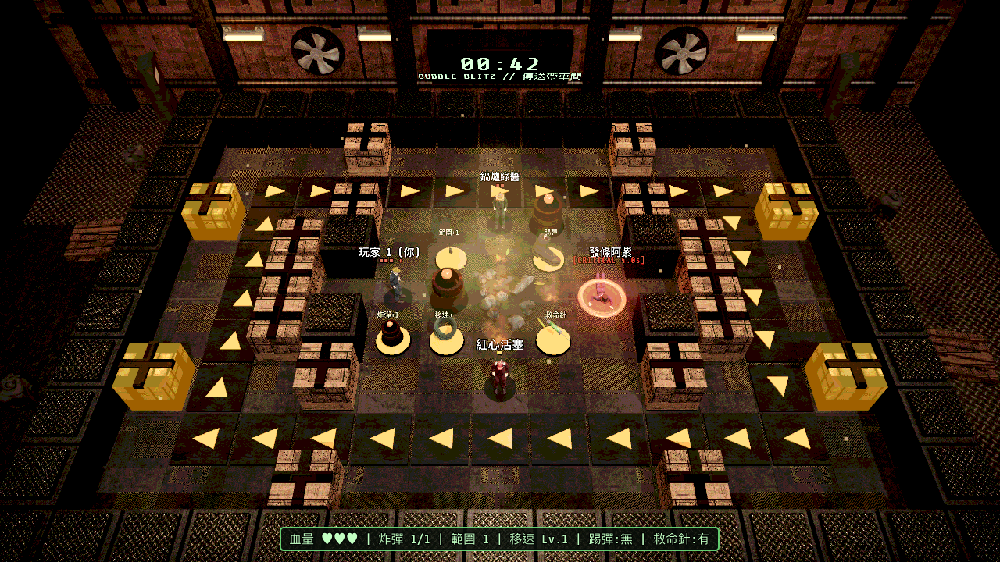

# Bubble Blitz（泡泡爆破）

`bubble-blitz` 是由 `machine-party-mod-manager` 开发维护的第一方原创 3D 泡泡堂×炸弹人结合版派对小游戏模组（通过 R2 + 目录 Worker 发布 ZIP 套件），接入**多小游戏共存注册中心（Multi-Minigame Coexistence Hub）**并占用原版未使用的 `Globals.MinigameIdentifier.ScavangerChairs = 8` 槽位，可与 [`roller-carnival`](../roller-carnival/README.md) 及未来更多自研小游戏同时安装、共同出现在官方默认轮换、自定义歌单、街机模式、本地同屏与过场 15 格 CRT 抽签池中。



- **模组 ID**：`bubble-blitz`
- **版本**：`0.1.7`（目录清单对应 `v0.1.7`）
- **授权**：`GPL-3.0-only`
- **目标游戏版本**：Steam Windows `v2.1.2`
- **开发与打包规范**：[自研模组开发、测试、接入与打包规范](../../docs/zh-CN/development/mod-development.md) · [ADR-009](../../docs/zh-CN/architecture/ADR-009-bundled-first-party-mods.md) · [ADR-015](../../docs/zh-CN/architecture/ADR-015-multi-minigame-hub.md)

## 核心玩法与预置规则（开箱即玩）

- **3 滴血结合版机制**：
  - 每名玩家开局拥有 **3 HP**（初始 1 个炸弹、1 格范围）。前 2 次被爆炸波击中时扣除 1 HP、触发原版喷血与 **1.5 秒无敌闪烁**。
  - 最后 1 HP 归零时进入 **4 秒重伤濒死状态**（原版倒地爬行动作 + 脚下红光警戒环）：
    - 期间被任意对手撞到即**立刻血雾处决淘汰**；
    - 若持有稀有被动道具**救命针（原版发光注射器）**，倒地 1.5 秒内未被处决将**自动自救恢复 1 HP**；
    - 4 秒超时或再次被爆炸波及则直接淘汰。
- **4 套随机多变地图（每局不同）**：
  - 房主每局随机抽取主题与种子，四象限对称生成原版木箱/金箱与隐藏道具，并强制保留每位玩家出生点周围的 L 形 3 格逃生安全区：
    1. **经典车间（Classic Grid）**：标准间隔铆钉铁柱与对称木箱。
    2. **十字通道（Cross Factory）**：中央宽阔十字大道，快速交火。
    3. **中央金库（Loot Vault）**：中心 3×3 高价值金箱（必掉强力道具），四周铁柱掩护。
    4. **传送带车间（Conveyor Belt）**：循环工业传送带，放到上面的炸弹会顺着轨道自动滑向对面。
- **动态人数自适应（2–16 人）**：
  - 2–4 人使用 `15×11` 竞技场，5–8 人扩展为 `17×13`，9–16 人扩展为 `19×15`。
- **原版 3D 道具池、临爆动画与 25 秒压板缩圈**：
  - 炸开木箱/金箱掉落 5 种复用原版 3D 模型的工业道具（带顶部 `Terminal F4` 标签）：`炸弹+1`（迷你压力罐）、`范围+1`（原版引爆器）、`移速+`（原版机械弹簧）、`踢弹`（原版大皮靴，被动撞击踢飞炸弹）、`救命针`（原版发光针筒）。
  - 炸弹临近引爆前通过脉动加速、充气膨胀、高频抖动与警示灯急闪直观预警；引爆时释放原版地雷爆炸粒子、烟尘与地面焦痕。
  - 底部提供仅自己可见的自适应居中 CRT 属性栏；单局 75 秒，最后 25 秒外圈螺旋落下重型工业压板缩圈（压板无视血量秒杀）。
- **综合计分**：按存活时间与主动击倒/处决对手次数综合排序，提交官方排名积分。
- **原生组队模式（配合 `team-party`）**：通过共享辅助模块 `team_support.gd` 读取房间组队注册表（未安装或未开启 `team-party` 时无痕降级为个人混战）。支持同队对角分组出生、友军炸弹火焰免疫、濒死倒地触发救援提示并由存活队友碰触救回 1 HP + 1.5 秒无敌、救援倾向 AI 行为、仅剩一队存活提前胜出以及 Fall Guys Squads 式小队同步计分。

## 操作按键

| 按键 | 功能 |
| --- | --- |
| `W / A / S / D` 或方向键 | 四方向移动（满速贴墙滑行 + 单轴拐角辅助对齐；拾取「踢弹」后撞向炸弹即可踢飞） |
| `Space`（空格） | 放置工业压力炸弹（2.4 秒后十字引爆，支持连锁引爆） |

## 文件结构

| 文件 | 打入 R2 ZIP | 职责 |
| --- | --- | --- |
| `mod.json` | 是 | 模组清单与入口声明 |
| `main.gd` | 是 | MPML API v2 入口：注册至多小游戏共存中心（槽位 `ScavangerChairs = 8`） |
| `config.gd` | 是 | 预置参数、4 套随机对称地图生成、动态尺寸与综合计分 |
| `arena_meshes.gd` | 是 | 程序化 3D 工业仓库舞台（混凝土/花纹钢板/高光滚轴对比材质）、原版排风扇/道具/油污贴花、水泡、传送带、道具、压板与 CRT 图标 |
| `fx_pool.gd` | 是 | 爆炸火焰、粒子、焦痕/血迹贴花、漂浮尘埃与灯光常驻对象池与错帧清理 |
| `ai_controller.gd` | 是 | 机器人避弹、寻路、放弹及组队救援 AI 决策 |
| `team_support.gd` | 是 | 共享可选组队辅助模块（读取 `team-party` 注册表并降级支持 FFA） |
| `bubble_blitz_game.gd` | 是 | 主游戏模拟与房主权威联机同步（含原生小队规则与封面截图） |
| `self_test.gd` | 是 | Godot headless `--self-test` 确定性验证与封面截图套件 |
| `official_minigame.gd` | 是 | 官方 `Minigame` 信号、参赛名单与结算入口 |
| `override_game.gd` | 是 | 多小游戏共存中心驱动：联机默认/自定义/街机轮换与场景加载 |
| `override_local_game.gd` | 是 | 多小游戏共存中心驱动：本地同屏轮换与场景加载 |
| `override_playlist.gd` | 是 | 多小游戏共存中心驱动：大厅自定义歌单多模组展示 |
| `override_picker.gd` | 是 | 多小游戏共存中心驱动：过场 15 格 CRT 抽签与三语简报 |
| `README.md` / `project.godot` / `bubble_blitz_scene.tscn` / `run_mac.sh` | 否 | 文档与 macOS 本地开发预览/测试辅助脚本 |

## 本地开发、自测与打包

```sh
# 1. macOS 独立试玩（含 3 名 AI 对手）
./mods/bubble-blitz/run_mac.sh play

# 2. 运行 Godot 4.5.2 headless 自测（输出 SELF_TEST_PASSED）
./mods/bubble-blitz/run_mac.sh --self-test

# 3. 截取 1280x720 封面图
./mods/bubble-blitz/run_mac.sh --screenshot catalog/covers/bubble-blitz.png

# 4. 校验打包、多小游戏共存回归测试与全仓契约
node scripts/pack-mod.mjs --all --verify-catalog
npm run check:architecture && npm test
```

## 验证状态

- ✅ macOS Godot 4.5.2 `--self-test`、多小游戏共存回归测试（与 `roller-carnival` 同时加载）及确定性 ZIP 打包校验通过。
- ⏳ Windows + Steam `v2.1.2` 实机联机对局与卸载还原待验收（目录当前保持 `verified: false`）。
