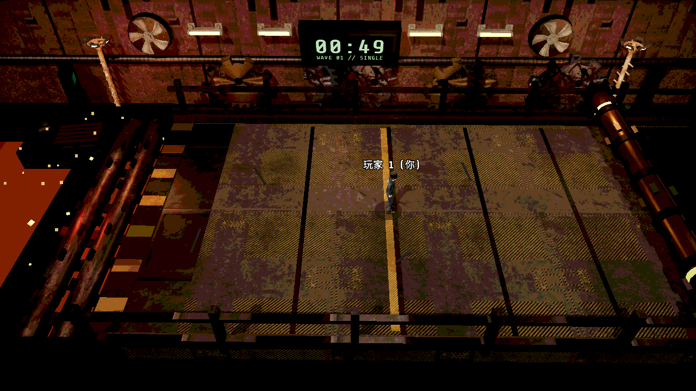

# Roller Carnival（滾筒嘉年華）

`roller-carnival` 是由 `machine-party-mod-manager` 開發維護的第一方原創 3D 躲避派對小遊戲模組（透過 R2 + 目錄 Worker 發布 ZIP 套件），接管原版《Machine Party》未使用的小遊戲槽位 `Globals.MinigameIdentifier.ShapeCutter = 6`，讓自研小遊戲能直接加入官方預設輪換、自訂清單、街機模式與過場 CRT 抽籤池。



- **模組 ID**：`roller-carnival`
- **版本**：`0.1.13`（目錄清單對應 `v0.1.13`）
- **授權**：`GPL-3.0-only`
- **目標遊戲版本**：Steam Windows `v2.1.2`
- **開發與打包規範**：[自研模組開發、測試、接入與打包規範](../../docs/zh-TW/development/mod-development.md) · [ADR-009](../../docs/zh-TW/architecture/ADR-009-bundled-first-party-mods.md)

## 核心玩法與計分規則

- **純淨橫向躲避＋擊退淘汰**：
  - **高處琥珀壓碎滾筒**：出現於中層高度，需按住 `S` 或 `↓` **下蹲**閃避。
  - **低處冷鋼滾筒**：貼地滾動，需按 `Space` / `W` / `↑` **跳躍**越過。
  - **只推擠不扣血**：被滾筒撞擊不會扣減 HP，而是觸發原版噴血與地面血跡貼花，並累積向左擊退約一個身位；被推入左側**雙軸粉碎熔爐坑**即立刻淘汰（觸發原版血霧與碎塊特效）。
- **同一起跑線齊平站位與動態人數（1–16 人）**：
  - 全員沿場景內側垂直黃銅起跑線一字排開，無水平移動操作，聚焦精準跳蹲時機。
  - 連線時依實際參賽名單與大廳外觀（帽子、眼鏡、西裝顏色）生成角色，房主判定碰撞、淘汰與得分，客端同步受擊血跡與動畫。
- **原版 CRT 介面與對局畫面**：
  - 開場播放 CRT 黑色過場幕（`ROUND X/Y` + 螢光綠標語）、原版「你 / YOU」四角定位框與 3-2-1-GO 機械倒數。
  - 場內後牆設有 3D CRT 倒數與波次監視器（最後 10 秒轉紅閃爍並提示音），搭配全螢幕暗角與 8 階色階後處理。
  - 僅保留純白粗黑框原版名牌；若想額外強化辨識自己，可搭配安裝獨立工具模組 [`player-spotlight`](../player-spotlight/README.md)（本模組已內建 `mpm_local_player` 標記供其自動接管）。
- **安全間隔底線保證**：
  - 50 秒分成三段：`WAVE 01 // SINGLE`（前 10 秒單根）→ `WAVE 02 // DOUBLE`（每組兩根）→ `WAVE 03 // OVERDRIVE`（32 秒起每組三根）。
  - 滾筒生成間隔強制滿足 `jump_air_time + landing_recovery_time + min_safe_reaction_time`，避免無解連發陷阱；另有 `max_same_type_streak` 限制同型連發。
- **依躲避數排名與階梯加分**：
  - 每次安全閃過滾筒累積 +1 次躲避；回合結束依躲避數排序發放排名加分（原始分為人數減名次加一，同躲避數並列；雙人第一、第二名分別提交 2、1 分，官方主遊戲套用倍率）。
- **原生組隊模式（配合 `team-party`）**：
  - 透過共享輔助模組 `team_support.gd` 讀取房間組隊註冊表（未安裝或未開啟 `team-party` 時無痕降級為個人混戰）。支援依隊伍分道排列 Z 軸起跑線、腳下隊色底座與隊伍前綴名牌、僅剩一隊存活提前勝出以及 Fall Guys Squads 式小隊同步計分。

## 操作按鍵

| 環境 | 按鍵 | 功能 |
| --- | --- | --- |
| 遊戲對局 | `S` / `↓` | 按住下蹲閃避高處琥珀滾筒，鬆手即起身；最多蹲 0.75 秒，再蹲需放開重按 |
| 遊戲對局 | `Space` / `W` / `↑` | 跳躍越過低處冷鋼滾筒 |

## Windows 實機安裝、使用與驗收流程

### 1. 安裝方式
- **透過管理器安裝（推薦）**：確認 Windows 已安裝 Steam 版 *Machine Party* `v2.1.2`（遊戲需先關閉），於管理器點選安裝／更新 **Roller Carnival (`v0.1.13`)**；若需同時啟用僅自己可見的頭頂聚光燈，一併安裝 **Player Spotlight (`v0.1.1`)**。管理器會自動設定內建載入器。
- **本機開發包直接實測**：在倉庫執行 `node scripts/pack-mod.mjs roller-carnival`（以及 `node scripts/pack-mod.mjs player-spotlight`），將對應 ZIP 解壓至遊戲目錄的 `mods/roller-carnival/`（與 `mods/player-spotlight/`），確認載入器已啟用後從 Steam 啟動遊戲。

### 2. 遊戲內使用流程
1. 從 Steam 啟動 *Machine Party*，建立線上房間（多人連線時，**房主與所有參賽玩家皆須安裝同版本 `roller-carnival`**；`player-spotlight` 則僅需想開啟聚光燈的玩家各自安裝）。
2. 在大廳可自由更換帽子、眼鏡與西裝顏色；進入自訂播放清單（Custom Playlist）勾選 **滾筒嘉年華（Roller Carnival）**（建議先選 2 輪測試），或直接開預設／街機輪換等待過場 CRT 抽中。
3. 過場 CRT 簡報會依遊戲語系顯示繁中／簡中／英文規則與操作提示；進入對局後等待黑幕與 `3-2-1-GO!` 結束即可開始跳蹲躲避。

### 3. Windows 雙人實機驗收清單
- **輪換與過場簡報**：確認自訂歌單、15 格過場 CRT 圖示與簡報說明（含繁／簡／英切換）正常顯示。
- **外觀與開場 UI**：確認雙方大廳穿戴的帽子／眼鏡／西裝顏色正確同步；CRT 黑幕、「你 / YOU」四角框與 3-2-1-GO 倒數及音效無異常。
- **操作與同步**：第一輪房主跳（測試 `Space` / `W` / `↑`）、客人長按蹲（`S` / `↓`，長按只蹲一次），再交換確認雙方動作同步與後段波次加速。
- **血跡、流暢度與淘汰**：故意撞擊滾筒確認**首次受擊噴血無明顯卡頓**、地面產生暗紅貼花（不浮空穿幫）、雙方皆看到受擊與推入粉碎坑的血霧碎塊，第二輪可正常銜接且分數正確結算。
- **搭配 `player-spotlight`（選測）**：確認僅自己看得到頭頂工業聚光燈、按 `F8` 可即時開關、淘汰後自動熄滅。
- **卸載與還原**：關閉遊戲後於管理器執行離線卸載，確認原版 `Machine Party.pck` 無損還原。

## 檔案結構（打入 R2 ZIP vs. 本機開發檔案）

依 [`scripts/pack-mod.mjs`](../../scripts/pack-mod.mjs) 規則，僅以下**執行期檔案**會被封裝為確定性 `roller-carnival-0.1.13.zip` 並隨目錄 Worker 與 R2 分發：

| 檔案 | 打入 R2 ZIP | 職責 |
| --- | --- | --- |
| `mod.json` | 是 | 模組中繼資料、入口腳本宣告與優先權 |
| `main.gd` | 是 | MPML API v2 入口：註冊虛擬腳本、場景 Hook與 `ShapeCutter` 替換 |
| `config.gd` | 是 | 預設平衡參數、安全生成間隔底線與積分計算 |
| `carnival_meshes.gd` | 是 | 程序化 3D 工業舞台（混凝土/拉絲重鋼板/高光滾筒材質、聚光燈池/SSAO/深度霧）、原版排風扇/道具/貼花與燈泡框建構器 |
| `fx_pool.gd` | 是 | 撞擊血花、淘汰血霧、熔岩上升火星與地面血跡貼花常駐物件池與視錐預熱 |
| `hud_ui.gd` | 是 | CRT 黑幕過場、四角定位框、倒數與分數結算面板 UI |
| `team_support.gd` | 是 | 共享可選組隊輔助模組（讀取 `team-party` 註冊表並降級支援 FFA） |
| `roller_carnival_game.gd` | 是 | 主遊戲場景迴圈、跳蹲物理、純擊退與淘汰判定、原生小隊規則與聯機同步 |
| `self_test.gd` | 是 | Godot headless `--self-test` 與封面截圖套件 |
| `official_minigame.gd` | 是 | 官方開局、參賽名單與結算入口 |
| `override_game.gd` | 是 | 多小遊戲共存中心覆寫 `res://scripts/scenes/game/game.gd`，將所有已註冊自研小遊戲納入官方預設與街機輪換池 |
| `override_local_game.gd` | 是 | 多小遊戲共存中心覆寫 `res://scenes/local_game/script/local_game.gd`，支援本機同螢幕輪換 |
| `override_playlist.gd` | 是 | 多小遊戲共存中心覆寫 `res://scenes/lobby/components/playlist_handler.gd`，於自訂歌單補入所有已註冊自研小遊戲 |
| `override_picker.gd` | 是 | 多小遊戲共存中心覆寫過場 `intermission_game_picker.gd`，補上 15 格 CRT 圖示與簡報說明 |
| `README.md` | 否 | 本說明文件（`*.md` 自動跳過） |
| `project.godot` | 否 | macOS 獨立 Godot 4.5.2 預覽專案設定 |
| `roller_carnival_scene.tscn` | 否 | 獨立啟動測試場景（`*_scene.tscn` 自動跳過） |
| `run_mac.sh` | 否 | macOS 本機試玩、`--self-test` 與封面截圖輔助腳本（`*.sh` 自動跳過） |

## 本機開發、打包測試與封面擷取

在安裝本機 Godot 4.5.2（`.agent/mod-dev/tools/Godot.app`）的 macOS 環境中，可直接執行。要預覽原版素材，可將環境變數 `MP_PCK_PATH` 指向本機的 `Machine Party.pck`。

```sh
# 1. 單人試玩：與正式對局共用倒數、操作及回合排名；結束後關閉視窗。
./mods/roller-carnival/run_mac.sh play

# 2. 執行 Godot headless 核心邏輯自我測試（應輸出 SELF_TEST_PASSED）
./mods/roller-carnival/run_mac.sh --self-test

# 3. 擷取舞台截圖至本機開發目錄
./mods/roller-carnival/run_mac.sh --screenshot

# 4. 驗證確定性 ZIP 打包、目錄契約、架構邊界與 Rust 測試
node scripts/pack-mod.mjs --all --verify-catalog
npm run check:architecture && npm test && npm run lint:rust && npm run test:rust
```

## 安裝、共存與驗證狀態

- **R2 鏡像分發與自動載入器**：桌面端透過目錄 Worker 從 R2 下載並校驗 `roller-carnival-0.1.13.zip` 的 SHA-256；首次安裝且偵測不到外部載入器時，管理器會透過潔淨室 `pck_loader.rs` + `mpm_bootstrap.gd` 自動設定載入環境；解除安裝最後一個受管模組時會無損截斷還原原版 `Machine Party.pck`。
- **外部載入器與互斥**：若玩家遊戲目錄已有 `MachinePartyModLoader.exe`，會保留原有載入器僅放入 `mods/roller-carnival/`；與 `overtime` 等直接修補 PCK 檔案的模組保持互斥保護。
- **目前驗證狀態**：
  - ✅ macOS Godot 4.5.2 語法檢查與 `--self-test` 通過、`scripts/pack-mod.mjs` 確定性 ZIP 與 Rust L1/L3 原版 Steam v2.1.2 `Machine Party.pck` 寫入/無損還原模擬測試通過。
  - ⏳ Windows Steam v2.1.2 實機對局（Worker 下載安裝、雙人連玩兩輪、歌單與輪換抽籤、多人連線 RPC 同步及解除安裝／還原）仍待 Windows 驗收後，再於 [`catalog/mods.json`](../../catalog/mods.json) 開放正式安裝（`"verified": true`）。
