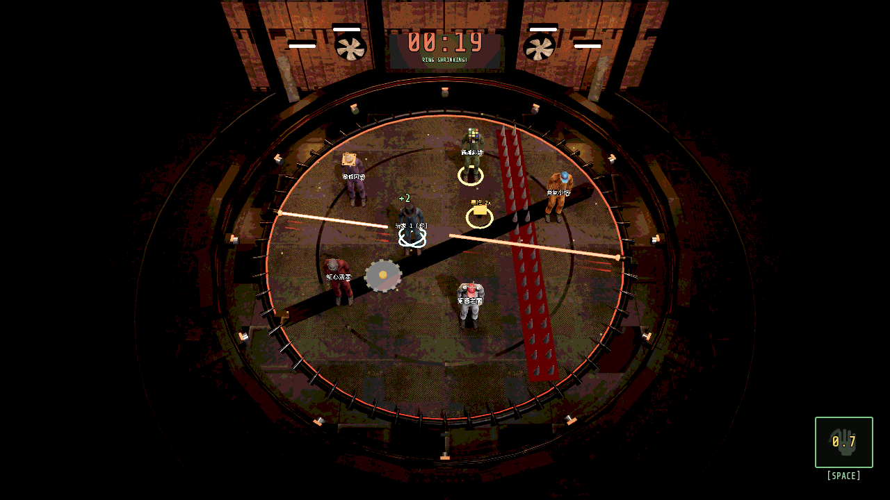

# Spike Ring（尖刺圆环）

`spike-ring` 是接入**多小游戏共存注册中心（Multi-Minigame Coexistence Hub）**的俯视 2.5D 圆形机械竞技场生存小游戏模组（通过 R2 + 目录 Worker 发布 ZIP 套件），占用原版未使用的 `Globals.MinigameIdentifier.BurnRecycle = 17` 槽位，可与 [`roller-carnival`](../roller-carnival/README.md)、[`bubble-blitz`](../bubble-blitz/README.md) 同时安装共存，共同出现在官方默认轮换、自定义歌单、街机模式、本地同屏与过场 15 格 CRT 抽签池中。



- **模组 ID**：`spike-ring`
- **版本**：`0.1.5`（目录清单对应 `v0.1.5`）
- **授权**：`GPL-3.0-only`
- **目标游戏版本**：Steam Windows `v2.1.2`
- **设计参数与算法细节**：[Spike Ring 设计与开发文档](DESIGN.md)
- **开发与打包规范**：[自研模组开发、测试、接入与打包规范](../../docs/zh-CN/development/mod-development.md) · [ADR-009](../../docs/zh-CN/architecture/ADR-009-bundled-first-party-mods.md) · [ADR-015](../../docs/zh-CN/architecture/ADR-015-multi-minigame-hub.md)

## 核心玩法与规则

- **3 秒准备 + 60 秒生存计时**：
  - 开局 3 秒准备期间可自由移动熟悉手感，不会出局且禁用推搡；倒计时结束后正式启动 60 秒计时、机关生成与推搡判定。
  - 所有玩家出局或 60 秒计时结束时进入本轮结算；出局玩家保持俯视全景观战，不中途复活。
- **多功能环形重工业测试井与三类机械机关**：
  - 58° 高角度斜俯视 3D 工业舞台（自带原版 CRT 倒计时控制台与角色贴地阴影），按人数动态缩放竞技场半径（`2–4` 人 `8.5m`、`5–8` 人 `10.5m`、`9–16` 人 `13.0m`）。
  - 按 `WARMUP → MIXED → FRENZY` 三阶段轮番触发**墙壁嵌入式缺口激光**（`y = 1.02m` 上身高度，自带 `3.1m` 随机安全缺口，同屏最多 1 道避免夹击）、**高速轨道电锯**与**伸缩机械地刺带**，最后 25 秒外圈机械尖刺环向内收缩；全部经过安全生成器校验。
- **纯键盘官方推搡与空投消耗品**：
  - 还原官方 *Disco Dodge* 推人动作与击退手感：按 `Space` 向前方扇形推搡对手（命中 `+2` 分并显示 3D 飘字、目标摔倒 `0.30s`、爬起 `0.20s` 免推、冷却 `1.5s`）。
  - 对局 `12s / 28s / 44s` 直接空投可见 3D 消耗品道具，触碰即拾取：**防爆护盾**（腰际双环力场，被动抵挡 1 次致命伤害）、**重推 2x**（脚下金色光环，下一次推人 2 倍击飞并重置冷却）、**360° 冲击波**（脚下红橘光环，下一次推人震飞周围所有对手）。
- **动态人数自适应与计分**：
  - 不写死人数上限，自动适配 2–16 人联机或本地对局；正式阶段每秒存活 `+1`、成功推倒对手 `+2`、60 秒存活完成额外 `+10`。
- **原生组队模式（配合 `team-party`）**：
  - 通过共享辅助模块 `team_support.gd` 读取房间组队注册表（未安装或未开启 `team-party` 时无痕降级为个人混战）。支持同队相邻环形出生、友军零推搡、`360°` 冲击波免伤队友、`3.5m` 防爆护盾共振、AI 仅锁定敌队目标、仅剩一队存活提前胜出以及 Fall Guys Squads 式小队同步计分。

## 操作按键

| 按键 | 功能 |
| --- | --- |
| `W / A / S / D` 或方向键 | 按屏幕方向移动并自动平滑转向 |
| `Space`（备用 `J / E`） | 向前方推搡对手（`1.5s` 冷却；持重推 2x / 360° 冲击波时自动触发强化效果） |

## 文件结构

| 文件 | 打入 R2 ZIP | 职责 |
| --- | --- | --- |
| `mod.json` | 是 | 模组清单与入口声明 |
| `main.gd` | 是 | MPML API v2 入口：注册至多小游戏共存中心（槽位 `BurnRecycle = 17`） |
| `config.gd` | 是 | 竞技场尺寸、难度曲线、关卡主题与同步参数配置 |
| `arena_meshes.gd` | 是 | 程序化圆形机械舞台（混凝土/拉丝钢板/铸铁对比材质）、原版工业道具/排风扇/油污贴花、机关缓存资源与 CRT 图标 |
| `hazard_director.gd` | 是 | 安全生成器、激光/电锯/地刺波次导演与缩圈尖刺环逻辑 |
| `fx_pool.gd` | 是 | 推搡命中与淘汰粒子、战斗焦痕贴花、闪光与微粒常驻对象池与视锥预热 |
| `ai_controller.gd` | 是 | 机器人避险走位与敌我目标推搡决策 |
| `team_support.gd` | 是 | 共享可选组队辅助模块（读取 `team-party` 注册表并降级支持 FFA） |
| `spike_ring_game.gd` | 是 | 主游戏模拟与房主权威联机同步（含原生小队规则） |
| `self_test.gd` | 是 | Godot headless `--self-test` / `--smoke-test` 与封面截图套件 |
| `official_minigame.gd` | 是 | 官方 `Minigame` 信号、参赛名单与结算入口 |
| `override_game.gd` | 是 | 多小游戏共存中心驱动：联机默认/自定义/街机轮换与场景加载 |
| `override_local_game.gd` | 是 | 多小游戏共存中心驱动：本地同屏轮换与场景加载 |
| `override_playlist.gd` | 是 | 多小游戏共存中心驱动：大厅自定义歌单多模组展示 |
| `override_picker.gd` | 是 | 多小游戏共存中心驱动：过场 15 格 CRT 抽签与三语简报 |
| `README.md` / `DESIGN.md` / `project.godot` / `spike_ring_scene.tscn` / `run_mac.sh` | 否 | 文档与 macOS 本地开发预览/测试辅助脚本 |

## 本地开发、自测与打包

```sh
# 1. macOS 独立试玩
./mods/spike-ring/run_mac.sh play

# 2. 运行 Godot 4.5.2 headless 自测（输出 SELF_TEST_PASSED）
./mods/spike-ring/run_mac.sh --self-test

# 3. 截取 1280x720 封面图（需传入绝对路径）
./mods/spike-ring/run_mac.sh --screenshot "$PWD/catalog/covers/spike-ring.png"

# 4. 校验打包、多小游戏共存回归测试与全仓契约
node scripts/pack-mod.mjs --all --verify-catalog
npm run check:architecture && npm test
```

## 验证状态

- ✅ macOS Godot 4.5.2 `--self-test`、多小游戏共存回归测试（与 `roller-carnival`、`bubble-blitz` 同时加载）及确定性 ZIP 打包校验通过。
- ⏳ Windows + Steam `v2.1.2` 实机联机对局与卸载还原待验收。
